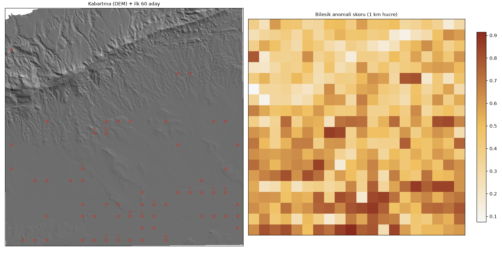
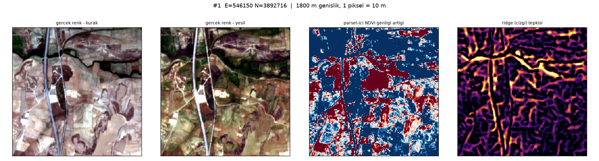

# arkeo — Serdarlı arkeolojik uzaktan algılama taraması

Kıbrıs'ın Serdarlı bölgesinde (AOI merkezi ~35.2525 N, 33.6008 E) arkeolojik
izleri uzaktan algılama ile bulmayı amaçlayan bir keşif çalışması. Sentinel-2
çok yıllı kompozitleri, Copernicus DEM ve hazır bir CNN modeli ("Enki") ile
aday hücreler skorlanır; sonuçlar harita ve görsel kartlar üzerinden incelenir.

## Yöntem

1. **`00_explore.py`** — AOI sınırlarını kurar, Copernicus DEM'i indirir ve
   Sentinel-2 L2A arşivini (bulut < %25) listeler.
2. **`01_composite.py`** — Çok yıllı, çok mevsimli Sentinel-2 medyan
   kompozitlerini üretir (`data/comp_*.tif`, 10 m, EPSG:32636).
3. **`02_analyze.py`** — Kompozitlerden yapısal/bitkisel anomali kanalları
   çıkarır ve hücreleri skorlar.
4. **`03_cards.py`** — Aday hücreler için görsel kart destesi ve genel bakış
   haritası üretir.
5. **`04_fieldaware.py`** — Tarla sınırını aşan ince çizgisellik fikrine dayalı
   v2 normalizasyon ve skorlama.
6. **`05_hires.py` / `06_pardl.py` / `07_tiles.py`** — Yüksek çözünürlüklü
   görüntü çekme, paralel indirme ve z=17 karo toplama.
7. **`08_cells.py`** — Karolardan 350×350 m hücre dizisi (`cells_rgb.npy`)
   ve hücre ızgarası üretir.
8. **`09_enki_infer.py`** — Enki modelini hücrelere uygular, skorları kaydeder.
9. **`10_enki_cards.py`** — En yüksek/düşük skorlu hücrelerin temas sayfaları.
10. **`11_pyramid.py`** — z=17 karolardan alt zoom seviyeleri (16/15/14).
11. **`12_server.py` + `viewer.html`** — `127.0.0.1:8787` üzerinde yerel karo
    sunucusu ve Leaflet tabanlı işaretleme arayüzü.

## Kurulum

```bash
python -m venv .venv
source .venv/bin/activate
pip install -r requirements.txt
```

## Çalıştırma

```bash
python 00_explore.py       # AOI + DEM + arşiv taraması
python 01_composite.py     # Sentinel-2 kompozitleri
python 02_analyze.py       # anomali kanalları ve skorlar
python 03_cards.py         # görsel kartlar
python 09_enki_infer.py    # Enki modeli ile skorlama
python 12_server.py        # görüntüleyici: http://127.0.0.1:8787
```

## Önizleme





Örnek aday kartları `cards/` klasöründe, harita ise `cards.html` içinde.

## Veri ve lisans notları

- **Sentinel-2 L2A** ve **Copernicus DEM** açık veridir; ilgili Copernicus
  lisanslarına tabidir.
- **Esri/Maxar World Imagery** yalnızca görsel inceleme amacıyla kullanılmıştır;
  bu katmandan üretilen görüntüler (`etek_*.png`, `chytri.png`, `hires_*.jpg`,
  Enki mozaikleri) lisans gereği bu depoya **dahil edilmemiştir** ve yeniden
  dağıtılmamalıdır.
- Büyük ara veri ve model dosyaları (`data/`, `datasets/`, `model/`) boyut
  nedeniyle depo dışında tutulur; scriptler bunları yeniden üretir.

## Notlar

Bu çalışma bir keşif/araştırma prototipidir; saha doğrulaması yapılmamıştır.
Aday konumlar kesin bulgu olarak değerlendirilmemelidir.
